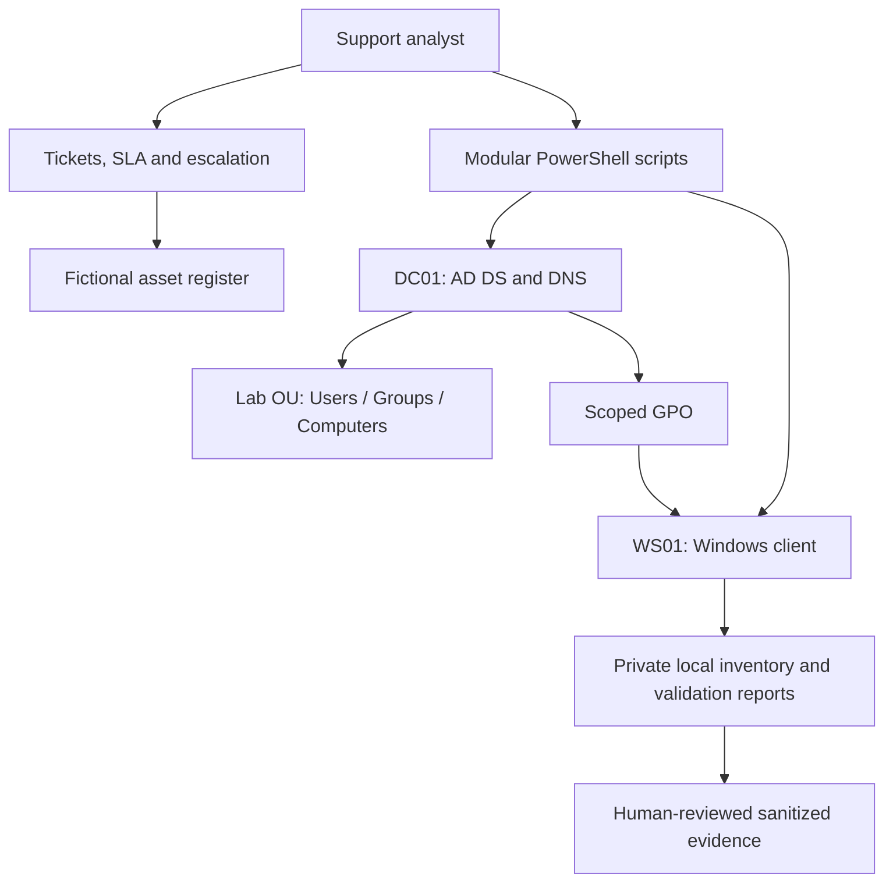

# Enterprise IT Support Lab

A practical Windows support portfolio by **Marom Gigi**: scoped PowerShell
automation, a small Active Directory lab design, troubleshooting runbooks and the
service records that connect technical work to a support outcome.

Support work rarely ends at finding the right command. An account needs an approval,
a workstation needs a recorded owner, and a fix needs a repeatable test. This project
puts those pieces together in an isolated, fictional company environment.

**Current scope:** authored scripts, sample data, runbooks and repository validation.
AD, GPO, domain join and imaging execution are **Requires Windows Lab Validation**.
No live enterprise, production service, commercial engagement or real user population
is represented. See [validation](docs/validation.md) and [evidence](evidence/README.md)
before interpreting any example as an observed result.

## Project goals

- Make common Tier 1/2 operations readable, repeatable and narrowly scoped.
- Connect onboarding, offboarding and workstation deployment to tickets and assets.
- Diagnose network faults by layer rather than making broad configuration changes.
- Show why a change is authorized, how to preview it and how to verify the outcome.
- Keep prior experience, newly authored lab work and future learning distinct.

## Architecture overview



The planned domain is `corp.example.test` on an isolated private VM network.
Infrastructure is provisioned manually so domain/DNS decisions remain explicit.
[Architecture](docs/architecture.md) covers sizing, trust boundaries and module
responsibilities; [setup](docs/setup-guide.md) walks through the lab build.

## Technologies and tools

| Area | Included here |
| --- | --- |
| Windows / Active Directory | PowerShell 5.1 scripts for RSAT AD DS and domain join |
| Group Policy | Scoped screen-lock automation and guided GPMC exercises |
| Networking | DNS, DHCP, TCP, ICMP, routing, Wi-Fi, RDP and HTTP/HTTPS runbooks |
| Device operations | CIM/registry inventory, asset lifecycle and health assessment |
| Imaging | Sysprep workflow, safe answer-file template and acceptance validator |
| ITSM | Incident/request/problem/change/knowledge examples, SLA and escalation |
| Quality | PSScriptAnalyzer, markdownlint, JSON/YAML/XML checks and Gitleaks CI |
| Version control | Git and GitHub Actions; no hosted ITSM service is required |

## Supported IT workflows

1. Approve a starter request, preview account creation, assign a role and hand over
   a validated device with a recorded asset ID.
2. Verify identity, inspect an account and perform an approved reset or unlock.
3. Triage a workstation or network fault, record evidence and escalate with ownership.
4. Disable a departing lab user and complete the manual access/session/asset checklist.
5. Validate an imaged workstation and convert its findings into a support report.
6. Turn a verified resolution into reviewed knowledge without publishing sensitive data.

The [support workflow](docs/it-support-workflow.md) describes ownership, waiting states,
reopening and user communication. Scripts implement technical steps; they do not
replace approvals, authorization, physical handover or user acceptance.

## Active Directory and GPO

The directory implementation creates protected Lab OUs and global security groups,
provisions single or CSV users, manages approved membership, resets passwords,
unlocks/disables accounts and inspects user state. New accounts remain disabled
until their role assignment succeeds. Inputs are validated before batch creation.
Operations reject users outside Lab Users and groups outside the managed group OU.

`WhatIf` previews mutations; an explicit domain controller and matching naming
context reduce accidental changes to another domain. Directory ACLs remain the
actual security boundary. [Directory documentation](docs/active-directory.md) includes
least-privilege roles, AGDLP and acceptance tests.

The automated GPO sets a 15-minute machine inactivity limit on the Lab Computers OU.
[Group Policy exercises](docs/group-policy.md) cover domain password/lockout policy,
drive mapping, desktop settings, selected settings restrictions, User versus Computer
OU scope, security filtering and a policy-not-applying investigation. An OU provides
placement/delegation and GPO links; a security group provides an ACL/filter principal.

## ITSM and SLA approach

[ITSM](itsm/README.md) defines P1–P4 impact/urgency examples, business-hour response
and restoration targets, escalation ownership and clock rules. The repository
contains [12 fictional tickets](itsm/sample-tickets/README.md),
[onboarding](itsm/onboarding-checklist.md) and [offboarding](itsm/offboarding-checklist.md)
checklists, plus a [knowledge base](itsm/knowledge-base/README.md).
Tickets include initial reports, diagnostic actions, proposed resolutions and closure
criteria. They are scenario drafts, not closed incidents or evidence of achieved SLAs.

## Device and asset management

The [asset register](assets/inventory.csv) records asset IDs, fictional serials,
assignment, OS, status, warranty, check-in and lifecycle stage. The
[lifecycle procedure](docs/device-management.md) covers allocation, custody, return,
replacement, sanitization and disposal. The inventory script collects Windows name,
logged-in user, OS, CPU, RAM, disks, IPv4 addresses, machine-wide installed software
and last boot time into private JSON. It avoids `Win32_Product`.

## Imaging and workstation deployment

[Imaging documentation](docs/windows-imaging.md) covers the golden image lifecycle,
Audit Mode, Sysprep, drivers, software, domain join timing, deployment acceptance
and rollback. The [answer file](scripts/imaging/unattend.xml) contains locale settings
only; no accounts, passwords, keys or disk-wipe directives are embedded.

The validator checks activation state without keys, network/DNS, system disk space,
services, application registry evidence, update/reboot evidence, name, domain and
bounded event errors. It reports Pass, Fail, Review or Unknown and makes no repairs.
PXE/WDS is a documentation exercise; MDT is explicitly a retired legacy topic.
No Windows media, captured image or proprietary installer is included.

## Automation scripts

| Entry point | Behavior | System changes |
| --- | --- | --- |
| [Invoke-LabDirectory](scripts/active-directory/Invoke-LabDirectory.ps1) | OUs, groups, users, membership, reset/unlock/disable/inspect | Selected scoped AD objects; WhatIf supported |
| [Import-LabUsers](scripts/active-directory/Import-LabUsers.ps1) | Validated CSV provisioning | Delegates to directory implementation |
| [New-LabEmployee](scripts/onboarding/New-LabEmployee.ps1) | Single approved account and role | Delegates to directory implementation |
| [Disable-LabEmployee](scripts/offboarding/Disable-LabEmployee.ps1) | Disable and remove managed roles | Does not revoke every existing session |
| [Join-LabDomain](scripts/active-directory/Join-LabDomain.ps1) | Join intended computer OU | Local/domain computer membership; manual reboot |
| [Set-LabGpo](scripts/group-policy/Set-LabGpo.ps1) | Dedicated computer screen-lock policy | GPO registry setting and scoped link |
| [Get-LabInventory](scripts/device-management/Get-LabInventory.ps1) | CIM and registry inventory | Local JSON/log files only |
| [Test-WorkstationHealth](scripts/device-management/Test-WorkstationHealth.ps1) | Shared deployment readiness checks | Local JSON/log files only |
| [Test-LabNetwork](scripts/networking/Test-LabNetwork.ps1) | Explicit DNS/ICMP/TCP probes | Network probes and local JSON/log files |
| [Collect-LabLogs](scripts/support/Collect-LabLogs.ps1) | Bounded event metadata, no messages | Local JSON/log files only |
| [Test-LabDeployment](scripts/imaging/Test-LabDeployment.ps1) | Post-imaging acceptance evidence | Local JSON/log files only |
| [New-SupportReport](scripts/support/New-SupportReport.ps1) | JSON findings to Markdown | Local report/log files only |

Each entry point provides comment-based help, parameters and validation. Shared
implementations handle logging/errors. Mutating operations support WhatIf; wrappers
forward it. Existing reports require explicit overwrite. WhatIf can still read state
and write a minimal operation log; read each script's help for its exact boundary.

## Troubleshooting scenarios

The [runbook index](runbooks/README.md) covers APIPA, DHCP failure, DNS failure,
IP-working/name-failing, default gateway, blocked port, Wi-Fi, RDP and HTTP/HTTPS.
Every runbook includes symptoms, causes, diagnostic steps, resolution, acceptance,
escalation and a ticket documentation example. GPO troubleshooting is documented
separately in [Group Policy](docs/group-policy.md).

## Security and privacy principles

Use least privilege, secure interactive credential entry, approved changes and
human-reviewed evidence. Fictional identities and `.test` names avoid employer data.
Generated reports may contain sensitive host details and are ignored by Git; review
them privately. Ignore rules and secret scanners do not replace access controls or
manual sanitization. See [security](docs/security.md) and
[responsible AI support](docs/ai-in-it-support.md) for handling rules.

## Repository structure

```text
.github/workflows/       CI for content, PowerShell, regression and secrets
assets/                 Fictional asset register
docs/                   Architecture, setup, operations, security and learning
evidence/               Capture instructions; no invented screenshots
itsm/                   SLA, checklists, tickets and knowledge base
runbooks/               Nine network troubleshooting procedures
sample-data/            Fictional CSV, configuration and report inputs
scripts/
  common/               Shared platform, logging and JSON output module
  active-directory/     Scoped directory actions, bulk import and domain join
  group-policy/         Scoped screen-lock GPO example
  onboarding/           Employee provisioning wrapper
  offboarding/          Employee disable wrapper
  device-management/    Inventory and health entry points
  networking/           Explicit-target diagnostics
  imaging/              Answer-file template and deployment validator
  support/              Event collection and support report generation
tests/                  Content, lint, parser and behavior checks
```

## Quick start

Start with local validation and a fictional report; no domain or administrator access
is needed for this path:

```powershell
git clone https://github.com/Marom313/enterprise-it-support-lab.git
Set-Location enterprise-it-support-lab
npm ci --ignore-scripts
npm test
./scripts/support/New-SupportReport.ps1 -InputPath ./sample-data/deployment-example.json
Get-Content ./outputs/support-report.md
```

The report renders fictional input; it does not test your workstation. For the real
lab, follow [setup-guide.md](docs/setup-guide.md), create DC01/WS01 and preview each
change before applying it. Outputs stay local and are not committed.

## Prerequisites

- Windows PowerShell 5.1 on a supported Windows lab host for AD/GPO operations.
- RSAT Active Directory/GroupPolicy modules and narrowly delegated lab rights.
- Domain-capable Windows client and licensed/evaluation Windows Server VMs.
- Isolated virtual network, snapshots and console access for fault exercises.
- Node.js 22+ and Git for repository checks; PSScriptAnalyzer 1.24.0 for lint.

## Running examples

From the repository root on an authorized Windows lab management host:

```powershell
./scripts/active-directory/Invoke-LabDirectory.ps1 -Action Initialize -Server DC01.corp.example.test -WhatIf
./scripts/active-directory/Import-LabUsers.ps1 -Server DC01.corp.example.test -CsvPath ./sample-data/users.csv -WhatIf
./scripts/onboarding/New-LabEmployee.ps1 -Server DC01.corp.example.test -Identity jordan.lake -GivenName Jordan -Surname Lake -WhatIf
./scripts/offboarding/Disable-LabEmployee.ps1 -Server DC01.corp.example.test -Identity alex.river -WhatIf
```

On a lab workstation, after reviewing local data collection:

```powershell
./scripts/device-management/Get-LabInventory.ps1 -WhatIf
./scripts/networking/Test-LabNetwork.ps1 -Target DC01.corp.example.test -Port 53 -WhatIf
./scripts/support/Collect-LabLogs.ps1 -Hours 4 -WhatIf
./scripts/imaging/Test-LabDeployment.ps1 -ExpectedName WS01 -WhatIf
Get-Help ./scripts/imaging/Test-LabDeployment.ps1 -Full
```

To apply a creation/reset, supply a SecureString entered with `Read-Host -AsSecureString`;
to join, supply `Get-Credential`. Never paste a password into a command or ticket.

## Testing and validation

```powershell
npm test
./tests/Test-PowerShell.ps1
./tests/Test-Behavior.ps1
```

The checks cover relative file links, JSON/YAML, XML well-formedness, PowerShell
syntax/lint, Markdown style, sample integrity, secret patterns and isolated report
behaviors. GitHub Actions also includes Windows PowerShell 5.1 compatibility and
Gitleaks history scanning. [Validation](docs/validation.md) records actual results
and the distinction between repository checks and Windows infrastructure tests.
There is no unconditional build badge or claim that unobserved CI runs passed.

## Screenshots and evidence

There are currently no infrastructure screenshots. The [evidence register](evidence/README.md)
lists the exact captures to add after execution and how to sanitize them. Example
JSON and ticket records are labeled fictional. Screenshots must accompany actual
test notes, OS versions and observed outcomes.

## Limitations

- AD, GPO, networking fault injection and imaging require independent lab execution.
- Bulk provisioning is not transactional; partial failures need directory review.
- Offboarding is incomplete without application/session/asset actions by their owners.
- Inventory omits some per-user, portable and Store software; application detection
  does not prove successful launch or licensing.
- Update evidence is not patch-compliance assessment; event reads are bounded.
- SLA values are examples; no real response/resolution metrics are claimed.
- The [macOS foundations](docs/macos-support-foundations.md) document is a **Learning
  Module, not Hands-On Experience**. Intune, SCCM, Jamf and Kandji experience is not claimed.

## Future improvements

Complete and publish sanitized Windows acceptance evidence first. Then add narrowly
scoped AD mock regression tests, a real file-server ACL exercise and an optional
tested ITSM service integration. Device-management platforms and macOS are separate
future learning projects, not existing capabilities of this lab.

## Skills demonstrated

The authored work demonstrates modular PowerShell design, support process modeling,
troubleshooting methodology, least-privilege reasoning, asset/imaging procedures,
documentation and repository quality controls. Practical execution claims should
expand only as actual lab evidence is collected.

Marom's prior experience includes B2B support, Windows/Linux, AD/GPO, permissions,
network troubleshooting, PC hardware assembly, OS installation and imaging, plus
beginner scripting and exposure to Python, Bash, PowerShell, Jenkins, GitHub Actions,
AWS and AI tools. This portfolio is not commercial enterprise administration.

## Author

Marom Gigi

- LinkedIn: [marom-gigi](https://www.linkedin.com/in/marom-gigi/)
- GitHub: [Marom313](https://github.com/Marom313)

Licensed under the [MIT License](LICENSE).
