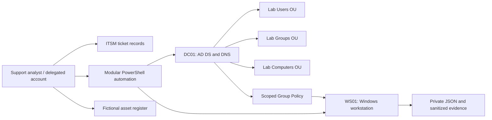

# Lab architecture

This is a portfolio lab with fictional identities, not a production service.
The repository contains implementation and operating procedures; the virtual
infrastructure must be built and validated separately.

## Network and compute

| Component | Planned configuration | Purpose |
| --- | --- | --- |
| Hypervisor | Hyper-V, VMware or VirtualBox | Isolated virtual machines |
| DC01 | Windows Server, 2 vCPU, 4 GB RAM | AD DS and DNS |
| WS01 | Supported Windows 11 Pro/Enterprise, 2 vCPU, 4–8 GB RAM | Domain client |
| Optional DHCP | Isolated VM network scope | DHCP fault exercises |
| Optional file server | Separate member server | Share and NTFS access exercises |

The example network is `192.168.56.0/24`, DC DNS `192.168.56.10`,
domain `corp.example.test`. These are plans, not detected host settings.
The example gateway `192.168.56.1` must exist on the chosen virtual network;
omit the gateway on a fully isolated segment. Do not expose a lab DHCP server
to a home, employer or public network. Use a separate NAT adapter only when needed
for licensed updates; avoid a multihomed DC in the initial lab.

## Boundaries and responsibilities

- `Lab.Common.psm1` owns file output, platform guards and minimal logging.
- `Invoke-LabDirectory.ps1` owns directory scope, validation and account changes.
- Onboarding, offboarding and CSV wrappers delegate to that implementation.
- Workstation health reuses deployment validation to prevent diverging checks.
- Human ticket ownership connects technical results, approvals and user confirmation.
- Generated reports stay in ignored `outputs/`; only reviewed fictional examples belong in Git.

Use separate standard and delegated administrator identities. Grant reset/unlock
rights on the Lab Users OU only; provisioning and GPO editing are distinct roles.
No script grants Domain Admin membership. A bootstrap administrator is needed to
create the initial structure; remove that access from routine support accounts.

## Validation boundary

Repository checks demonstrate syntax, data integrity and selected isolated behaviors.
They do not demonstrate domain replication, policy application, imaging success,
user acceptance or deployed infrastructure. See [evidence](../evidence/README.md).
