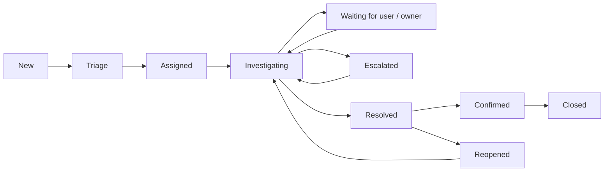

# Support workflow and user communication

At intake, record the affected service/device, symptoms in the user's words, scope,
start time, recent changes, impact and a safe contact method. Verify identity before
account changes. Set priority using the [SLA model](../itsm/README.md), assign an owner
and communicate the next update time. Keep ownership visible during escalation.

Use observation before remediation. Test one hypothesis at a time, record commands
and outcomes and separate user symptoms from inferred causes. Obtain the relevant
change approval before configuration changes. Record previous state and rollback.
Never include credentials, full user documents or unrestricted event messages in
a ticket. Store sensitive evidence only in the approved private location.

Resolution requires the original workflow to succeed, not merely a passing ping.
Record the fix, independent verification, user confirmation, remaining risks and
related knowledge/problem/change records. If a user is unavailable, follow the
documented follow-up policy; do not invent confirmation. Reopen when the symptom
returns and link recurring incidents to problem investigation.

## Communication examples

Acknowledgement: “I understand you cannot access the Operations share on WS01.
I am checking whether this affects the workstation or the service. My next update
will be by 11:00. Please do not send your password.”

Progress: “The workstation reaches the server, but name resolution is failing.
I have passed the DNS evidence to the infrastructure owner. You still have one
ticket owner, and I will update you by 12:00 even if the repair is ongoing.”

Sensitive action: “I have verified the approved reset request. Please enter the
temporary secret through our approved channel and change it at sign-in; I do not
need to know your password.”

Closure request: “The approved DNS configuration has been restored. The portal now
resolves and opens from WS01. Please confirm your normal workflow works before
I close the incident.”
